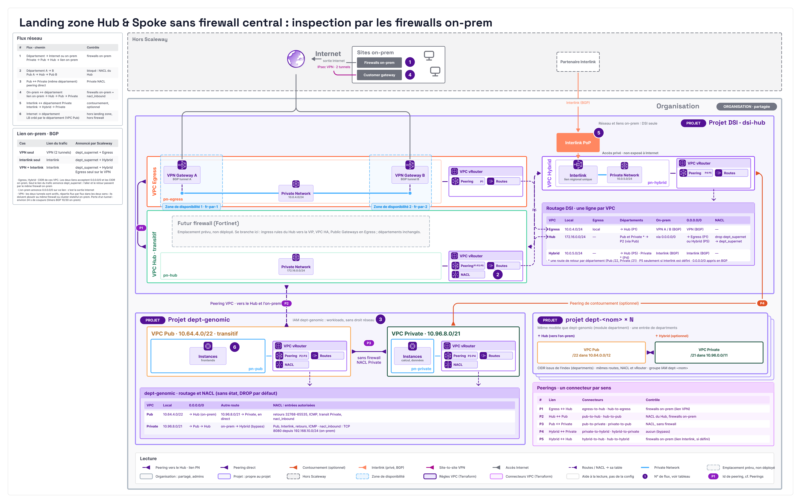

# Landing zone Scaleway : hub and spoke sans firewall

Socle réseau d'une organisation Scaleway, écrit en Terraform. Un projet central (la DSI) héberge le hub et les liens vers l'on-prem : VPN site à site et Interlink. Il n'y a **aucun firewall dans Scaleway** : les firewalls on-prem existants du client filtrent tout. Chaque département a son propre projet, créé et détruit à la demande.

**Garantie.** Tout flux qui sort d'un département (Internet comme on-prem) passe par le lien on-prem et les firewalls on-prem. Seule exception : le contournement Interlink optionnel (`hybrid_bypass`), qui rejoint directement l'on-prem. Ce qu'un département expose lui-même (Load Balancer, IP publique) n'est pas couvert : voir les limites.

Un seul module racine, un seul state, un seul fichier de configuration : `terraform.tfvars`.

```text
main.tf, variables.tf, outputs.tf   module racine
terraform.tfvars.example            modèle de configuration
modules/hub/                        DSI : VPC Egress, Hub, Hybrid, VPN, Interlink
modules/department/                 un département : projet, VPC, NACL, IAM
tests/, modules/*/tests/            tests hors ligne
docs/                               documentation
```

## Architecture

[](docs/architecture.png)

Le hub est un VPC transitif. Un département y accède par son VPC Pub, et le hub renvoie tout ce qui n'est pas local (Internet et on-prem) vers le lien on-prem.

| Flux | Chemin | Contrôle |
|---|---|---|
| Département → Internet | Private → Pub → Hub → Egress (VPN) ou Hybrid (Interlink) → on-prem | firewalls on-prem (sortie Internet de l'on-prem) |
| Département → on-prem | idem | firewalls on-prem |
| On-prem → département | lien on-prem → Hub → Pub → Private | firewalls on-prem et `nacl_inbound` |
| Département A → département B | Pub A → Hub → Pub B | bloqué par une règle `drop` de la NACL du Hub (les deux sens, tous les ports) |
| Pub ↔ Private (même département) | peering direct | NACL |
| On-prem (Interlink) ↔ Private | Interlink → Hybrid → Private | `hybrid_bypass`, NACL |
| Internet → département | Load Balancer créé par le département | hors landing zone |

**Lien on-prem.** Le lien qui porte le trafic des départements est choisi automatiquement : Interlink s'il est défini, sinon le VPN. On démarre donc sur le VPN et on passe sur Interlink en ajoutant `interlink`. Seul ce lien annonce `dept_supernet` à l'on-prem, pour que le retour revienne par le même firewall on-prem (qui garde l'état des flux). Les deux liens acceptent `0.0.0.0/0` et les CIDR on-prem.

**Côté on-prem.** Il doit annoncer `0.0.0.0/0` en BGP sur ce lien : c'est la sortie Internet de la landing zone. Ses firewalls doivent autoriser `dept_supernet` (`10.64.0.0/10` par défaut).

Schémas des mécanismes : [peering](docs/notion-1-vpc-peering.png), [transitivité](docs/notion-2-transitivite.png), [NACL](docs/notion-4-nacl.png), [flux asymétriques](docs/notion-5-flux-asymetriques.png).

### Routes

| VPC | Destination | Prochain saut |
|---|---|---|
| Private (département) | `0.0.0.0/0` | Pub |
| Pub (département) | `0.0.0.0/0` | Hub |
| Pub (département) | Private du département | Private |
| Hub | `0.0.0.0/0` | Egress (VPN seul) ou Hybrid (Interlink défini) |
| Hub | Pub et Private de chaque département | Pub du département |
| Egress | `dept_supernet` | Hub |
| Hybrid (Interlink défini) | `dept_supernet` | Hub |

Filtres BGP :

| Cas | VPN `prefix_filter_out` | Interlink `prefix_filter_out` | `prefix_filter_in` |
|---|---|---|---|
| VPN seul | `dept_supernet`, CIDR Egress | | `0.0.0.0/0` + CIDR on-prem |
| Interlink seul | | `dept_supernet`, CIDR Hybrid | `0.0.0.0/0` + CIDR on-prem |
| VPN + Interlink | CIDR Egress | `dept_supernet`, CIDR Hybrid | `0.0.0.0/0` + CIDR on-prem du lien |

## Ajouter un firewall dans le hub

Le client garde ses firewalls on-prem pour l'instant et peut installer plus tard des appliances (Fortinet par exemple) dans le hub. Le module `modules/department` et les states des départements ne changent pas. Les étapes, dans `modules/hub/` (voir le commentaire en tête de `network.tf`) :

1. Ajouter un VPC HA (un CIDR) pour la synchronisation des nœuds.
2. Brancher chaque nœud sur le Private Network du Hub et sur celui d'Egress.
3. Créer sur le VPC Hub des `scaleway_vpc_ingress_rule` depuis `dept_supernet` et les CIDR on-prem, avec la VIP du firewall comme prochain saut. Elles remplacent la route `0.0.0.0/0` du Hub (`hub_default`).
4. Créer des Public Gateways dans le VPC Egress pour la sortie Internet, et passer les routes de sortie des firewalls par elles.

Une implémentation OPNsense en haute disponibilité de cette insertion existe sur la branche `main` de ce dépôt (`modules/hub/firewall.tf`, `modules/hub/failover.tf`) : utilisez-la comme référence.

## Prérequis

**Outils.**

| Outil | Version minimale | Pourquoi |
|---|---|---|
| Terraform | 1.10 | `required_version = ">= 1.10"` |
| Provider `scaleway/scaleway` | 2.86 (`~> 2.86`) | installé par `terraform init` |
| Provider `hashicorp/time` | `~> 0.12` | installé par `terraform init` |

**Droits Scaleway.**

- Une clé API d'**organisation** : elle crée des projets, groupes et politiques IAM, et gère VPC, VPN et Interlink. Une clé d'administrateur convient.
- Un bucket Object Storage **privé et versionné** pour le state. Réservez-le aux opérateurs.

**Côté on-prem.** Une passerelle VPN (IP publique, AS BGP) et, pour Interlink, un PoP et un partenaire ou une connexion en propre. Le routeur on-prem annonce `0.0.0.0/0`.

**Variables d'environnement.** Ne les versionnez jamais.

```bash
export SCW_ACCESS_KEY=<clé> SCW_SECRET_KEY=<secret> SCW_DEFAULT_ORGANIZATION_ID=<id-organisation>
export AWS_ACCESS_KEY_ID=$SCW_ACCESS_KEY AWS_SECRET_ACCESS_KEY=$SCW_SECRET_KEY   # accès au bucket du state
export STATE_BUCKET=<bucket-du-state>
```

La région (`fr-par`) est écrite dans `main.tf` ; c'est celle du bucket.

## Déploiement

Toutes les commandes se lancent depuis la racine du dépôt.

1. Créer la configuration :

   ```bash
   cp terraform.tfvars.example terraform.tfvars
   ```

   Renseignez `vpn` (ou `interlink`) et vos `departments`. Au moins un des deux liens est obligatoire. Toutes les options : [docs/CONFIGURATION.md](docs/CONFIGURATION.md).

2. Initialiser, relire le plan, appliquer :

   ```bash
   terraform init -backend-config="bucket=$STATE_BUCKET"
   terraform plan
   terraform apply
   ```

3. Configurer l'on-prem avec `terraform output vpn` (IP des passerelles, adresses BGP, secret des PSK) et `terraform output -json interlink` (clé d'appairage). Vérifier que les sessions BGP montent et que l'on-prem annonce `0.0.0.0/0`.

4. Vérifier : `terraform output departments` et `scw vpc vpc-connector list region=fr-par` (tous les connecteurs doivent être `peered`). Vérifier aussi qu'un flux entre deux départements est bloqué (voir « Limites connues »).

**Tests hors ligne** (aucun appel à Scaleway) :

```bash
terraform init -backend=false && terraform test
terraform -chdir=modules/hub init -backend=false && terraform -chdir=modules/hub test
terraform -chdir=modules/department init -backend=false && terraform -chdir=modules/department test
```

## Exploitation

Après chaque modification de `terraform.tfvars` : `terraform plan`, relecture, puis `terraform apply`.

**Ajouter un département.** Ajoutez une entrée dans `departments` avec un `index` unique (0-1023), puis `terraform apply`. Le plan ne doit montrer que les ressources du nouveau département. Ne changez jamais l'`index` d'un département existant.

```hcl
departments = {
  genomic   = { index = 1 }
  marketing = { index = 2 }
}
```

Dans la même entrée : `nacl_inbound` ouvre un flux entrant, `hybrid_bypass = true` relie le département à Interlink (demande `interlink`).

**Retirer un département.** Le département vide d'abord son projet (instances, LB, volumes, bases, buckets). Supprimez ensuite son entrée et lancez `terraform apply`. Gardez son `index` réservé tant que le projet n'est pas détruit.

**Passer du VPN à Interlink.** Ajoutez `interlink` et appliquez. La route par défaut du Hub passe sur Hybrid et `dept_supernet` n'est plus annoncé par le VPN. Prévenez l'on-prem : il doit annoncer `0.0.0.0/0` sur l'Interlink et connaître `dept_supernet` par lui. La bascule coupe les flux en cours.

**Détruire.**

```bash
terraform destroy
```

Les ressources des départements (instances, LB, volumes, bases, buckets) doivent être supprimées avant. Si l'erreur `resource is still in use` apparaît, supprimez les security groups « Default » créés par Scaleway dans le projet du département, puis relancez :

```bash
scw instance security-group list zone=fr-par-1 project-id=<id-projet-département>
scw instance security-group delete <id> zone=fr-par-1
```

Faites de même dans `fr-par-2` si des VM y ont tourné. Récupérez les `project_id` avec `terraform output departments` avant la destruction.

Les secrets des PSK (un par tunnel, `connection_<id>` dans Secret Manager) sont créés par Scaleway et restent après la destruction : supprimez-les à la main si besoin.

## Dépannage

| Symptôme | Cause | Action |
|---|---|---|
| Pas d'Internet depuis un département | l'on-prem n'annonce pas `0.0.0.0/0` sur le lien, ou ses firewalls bloquent `dept_supernet` | vérifier la session BGP et les routes reçues |
| Les flux partent mais ne reviennent pas | l'on-prem ne connaît pas `dept_supernet`, le retour passe par l'autre lien, ou les deux tunnels VPN aboutissent à deux firewalls différents | vérifier que le lien qui porte le trafic annonce `dept_supernet` et que les deux tunnels arrivent sur le même firewall ou cluster |
| `Connection timed out during banner exchange` vers une VM | port fermé par la NACL du département | ajouter une règle `nacl_inbound`, puis `apply` |
| Le plan refuse les CIDR | chevauchement entre `cidrs`, `dept_supernet` et les CIDR on-prem | corriger les valeurs |
| `Set vpn or interlink` | ni `vpn` ni `interlink` | définir au moins un lien |
| `hybrid_bypass needs interlink to be set` | `hybrid_bypass = true` sans `interlink` | définir `interlink` ou repasser à `false` |
| `each department needs a unique index` | deux départements ont le même `index` | donner un `index` libre (jamais à un département déjà déployé) |
| `resource project with ID ... is not found` à la création d'un département | projet neuf pas encore connu de l'API VPC | relancer `terraform apply` |
| `resource is still in use` à la destruction | security group « Default » dans le projet du département | voir « Détruire » |

## Limites connues

- **Lien on-prem unique.** Tout le trafic des départements passe par un seul lien : sa bande passante et sa latence limitent la landing zone. Il n'y a pas de bascule automatique entre VPN et Interlink : changer de lien est une opération manuelle.
- **Dépendance à l'on-prem.** L'on-prem doit annoncer `0.0.0.0/0` et laisser passer `dept_supernet`. Sans cela, plus d'Internet pour les départements.
- **Exposition directe.** Les chemins Internet créés par un département ne passent pas par l'on-prem : IP publique d'instance (`InstancesFullAccess`), Load Balancer, nœuds Kapsule avec IP publique. Le contrôle passe par IAM et par un inventaire des projets de département (`scw instance ip list project-id=<projet>`, `scw lb list project-id=<projet>`). Retirer `InstancesFullAccess`, `LoadBalancersFullAccess` ou `KubernetesFullAccess` de `iam_permission_sets` ferme ces voies.
- **Entre départements.** Aucun firewall : une règle `drop` de la NACL du VPC Hub bloque tout trafic entre deux départements, dans les deux sens et sur tous les ports. Une règle `nacl_inbound` qui désigne un autre département comme source n'a donc aucun effet tant que cette règle existe. Vérifiez le blocage après chaque déploiement : une fois, la règle a laissé passer une partie des connexions TCP jusqu'à ce que Terraform la réapplique. Pas de routes IPv6.
- **Produits sans peering.** Redis, MongoDB, Kafka, OpenSearch et ClickHouse ne suivent pas le routage VPC : ils ne sont joignables que depuis leur Private Network.
- **Nouveaux départements.** Les VM déjà démarrées reçoivent les nouvelles routes par DHCP en jusqu'à 1 h.
- **Quota de peering.** 512 connecteurs par organisation : 127 départements sans bypass, 85 avec.
- **Un seul state.** Un `plan` regarde la DSI et tous les départements, et un `apply` verrouille le tout. Relisez chaque plan.
- **Deux tunnels VPN actifs.** Scaleway répartit les flux sur les deux tunnels, et l'on-prem choisit le tunnel de retour par son propre ECMP. Les deux tunnels doivent donc aboutir au même firewall on-prem, ou à un cluster qui partage l'état des sessions. Scaleway n'expose aucun timer BGP, BFD ou DPD : la vitesse de bascule entre les deux tunnels se règle sur la passerelle on-prem. MTU de chemin par le VPN : 1438 octets.
- **Interlink non testé en réel**, ni `hybrid_bypass` ni le passage du VPN à Interlink : seul le chemin VPN a été validé.

## Documentation

- [docs/CONFIGURATION.md](docs/CONFIGURATION.md) : toutes les options.

## Licence

Apache License 2.0 : voir [LICENSE](LICENSE).
